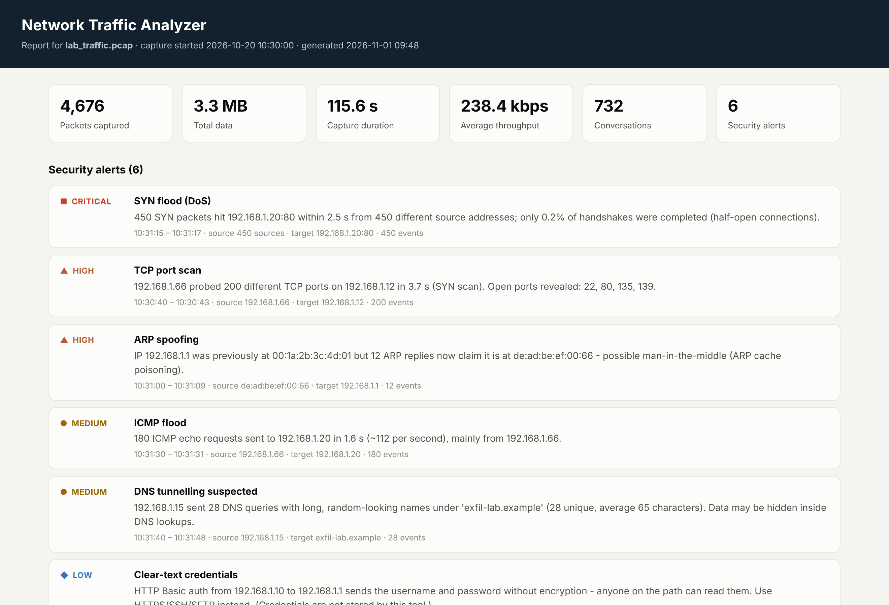
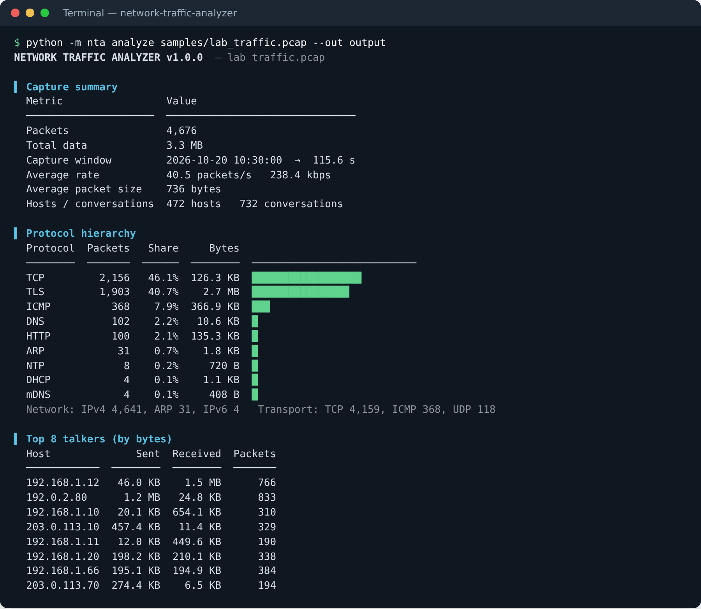
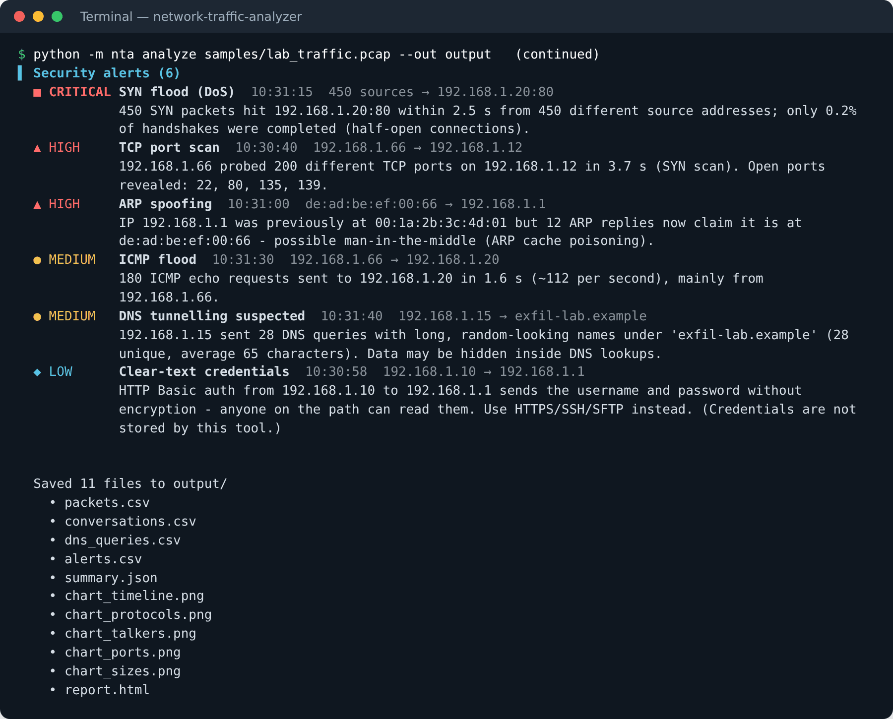
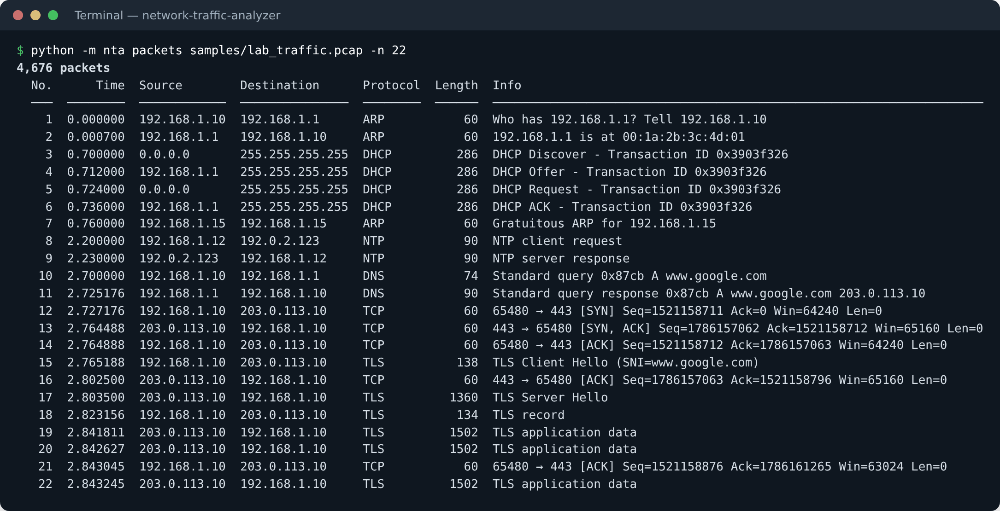
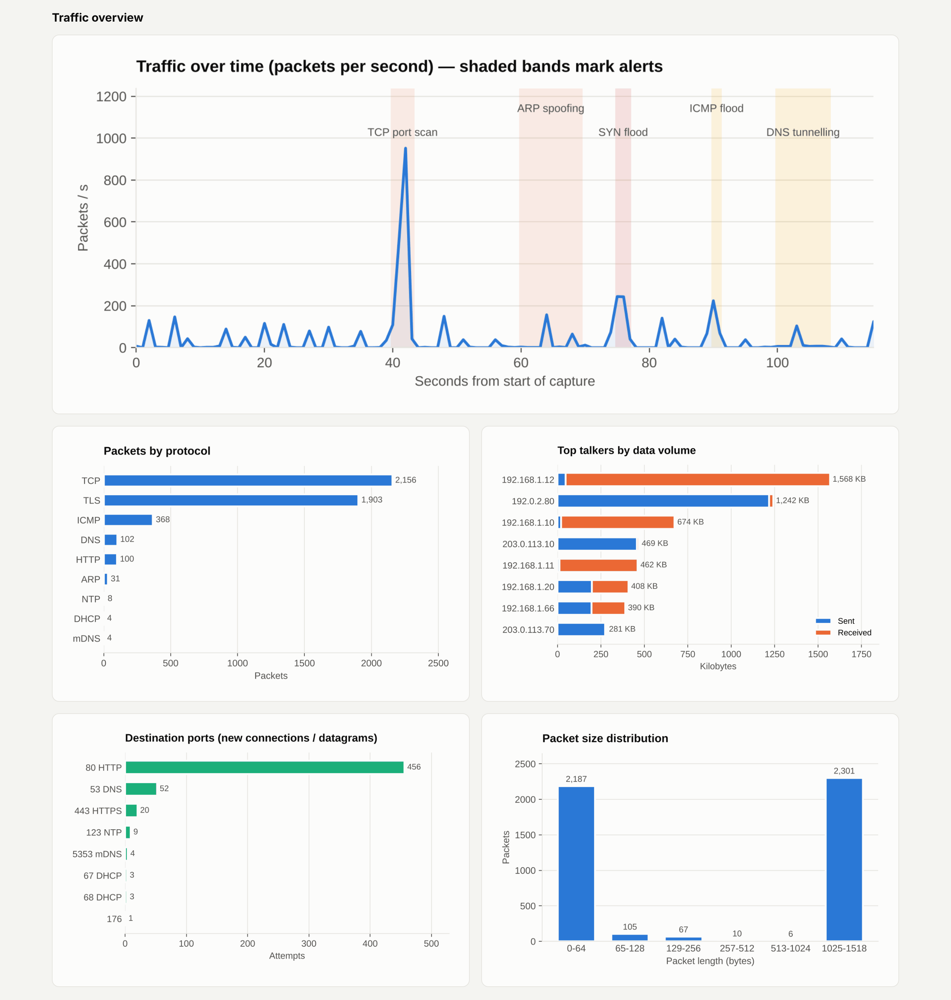
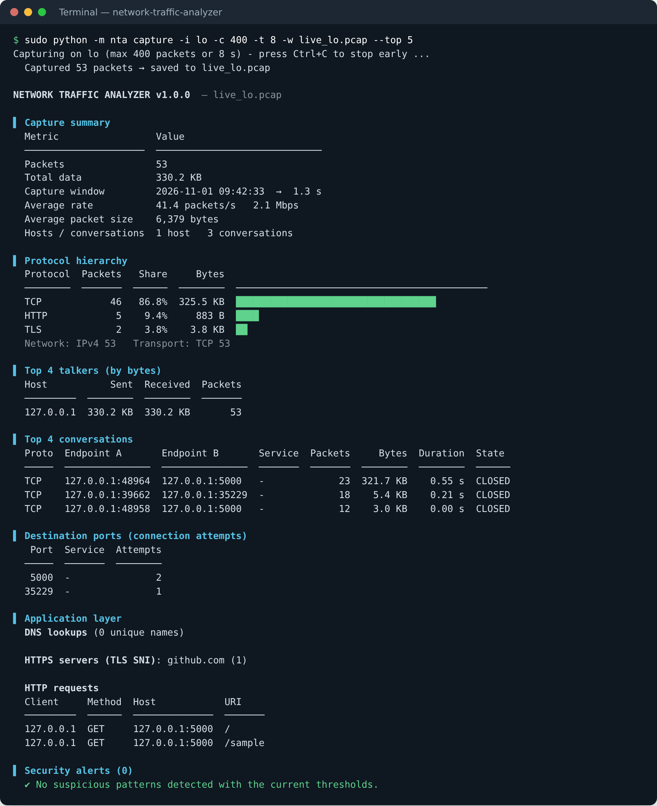
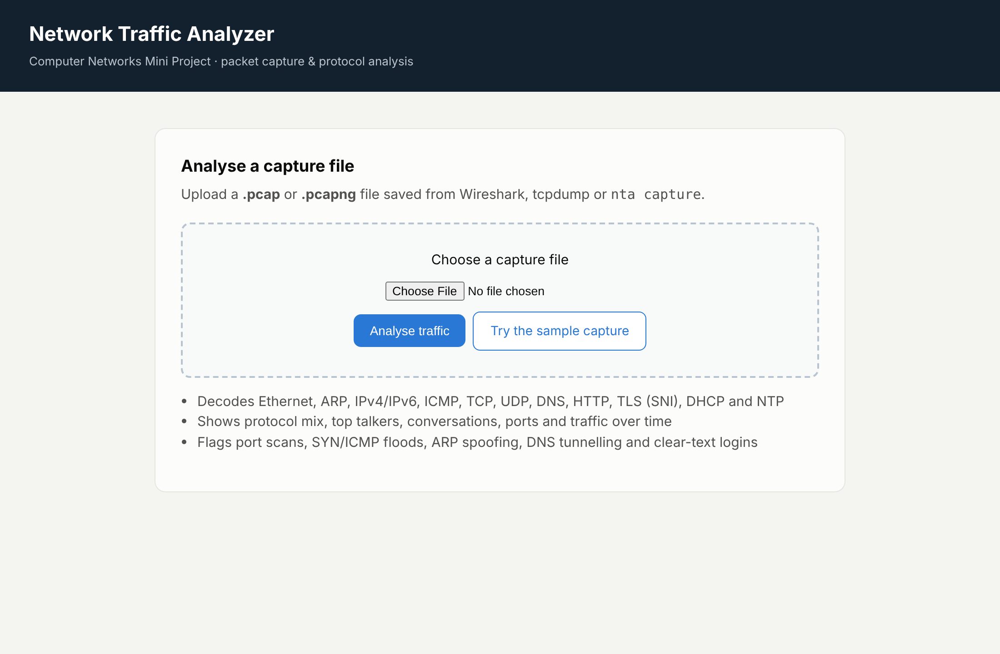
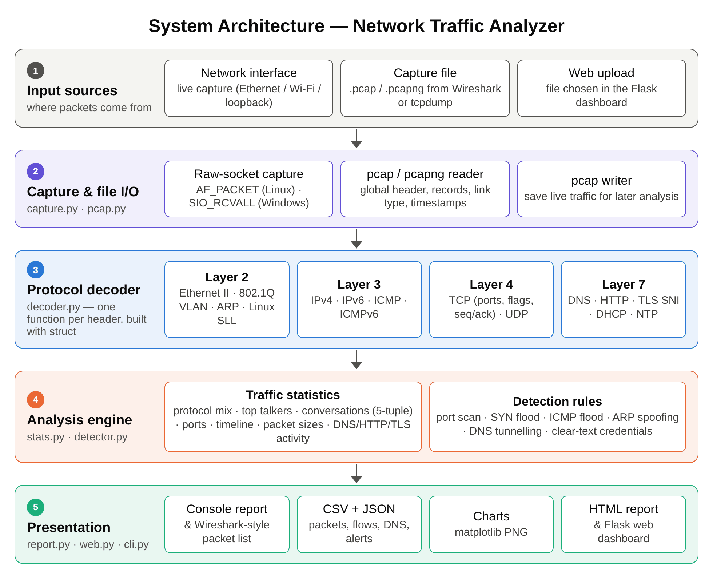

# Network Traffic Analyzer

**Packet capture, protocol analysis and suspicious-traffic detection in pure Python.**


Mini project for the **Computer Networks** course — B.Tech Computer Science Engineering,
Unitedworld Institute of Technology, Karnavati University (July – November 2026).

| | |
|---|---|
| **Student** | Aryan Minish Kanjiraparambil |
| **Enrolment No.** | 202407020024 |
| **Roll No.** | KU2407U024 |
| **Project mentor** | Ms. Pragya Vats |
| **Repository** | https://github.com/AryanMinish/network-traffic-analyzer |

---

## What it does

The analyzer reads capture files (`.pcap` / `.pcapng` from Wireshark or tcpdump) or captures live
traffic from a network interface, then decodes every packet **layer by layer** and tells you what is
happening on the network:

- **Decodes 12 protocols by hand** (no Scapy, no libpcap) — Ethernet II, 802.1Q VLAN, ARP, IPv4, IPv6,
  ICMP/ICMPv6, TCP, UDP, DNS, HTTP/1.x, TLS (Server Name Indication), DHCP and NTP.
- **Summarises traffic** — protocol hierarchy, top talkers, conversations (5-tuple flows with TCP state),
  destination ports, packet sizes and packets-per-second over time.
- **Flags suspicious activity** with six explainable rules — TCP port scan, SYN flood, ICMP flood,
  ARP spoofing, DNS tunnelling and clear-text credentials.
- **Reports** as a coloured console report, a Wireshark-style packet list, CSV/JSON exports,
  charts, a self-contained HTML report and a Flask web dashboard.



## Quick start

```bash
git clone https://github.com/AryanMinish/network-traffic-analyzer.git
cd network-traffic-analyzer
pip install -r requirements.txt          # optional: matplotlib (charts) + Flask (dashboard)

python -m nta analyze samples/lab_traffic.pcap --out output
```

The core analyzer needs **only the Python standard library** — without the optional packages
everything works except the charts and the web dashboard.

## Usage

| Command | What it does |
|---|---|
| `python -m nta analyze FILE [--out DIR]` | Full analysis of a `.pcap`/`.pcapng` file; `--out` also writes CSV, JSON, charts and `report.html` |
| `python -m nta packets FILE [-n 30] [-p DNS]` | Wireshark-style packet list, optionally filtered by protocol |
| `sudo python -m nta capture -i eth0 -c 500 -t 30 [-w file.pcap]` | Live capture (Linux: interface name; Windows: run as Administrator, `-i` = your local IP) |
| `python -m nta dashboard` | Web dashboard on http://127.0.0.1:5000 — upload a capture and get the report |
| `python -m nta interfaces` | List network interfaces |

Detection thresholds can be tuned, e.g. `--scan-ports 10 --flood-syns 100`.

> **Live capture** uses raw sockets, so it needs root/Administrator rights. On macOS, capture with
> Wireshark or tcpdump and analyse the saved file. Only capture on networks you own or are allowed to monitor.

## Screenshots

| Console report | Security alerts |
|---|---|
|  |  |

| Packet list | Traffic charts (HTML report) |
|---|---|
|  |  |

| Live capture on a real interface | Web dashboard |
|---|---|
|  |  |

## How it works



1. **Capture / file I/O** — `pcap.py` parses the pcap global header and records (and pcapng blocks);
   `capture.py` opens an `AF_PACKET` raw socket on Linux or a `SIO_RCVALL` raw socket on Windows.
2. **Decoder** — `decoder.py` unpacks each header with `struct` in network byte order and hands the payload
   to the next layer: EtherType → IP protocol number → port / payload signature.
3. **Analysis** — `stats.py` aggregates packets and bidirectional conversations; `detector.py` applies the rules
   using sliding time windows.
4. **Presentation** — `report.py` (console, CSV, JSON, charts, HTML), `web.py` (Flask) and `cli.py` (argparse).

### Detection rules

| Rule | Logic | Default threshold | Severity |
|---|---|---|---|
| TCP port scan | One source sends SYNs to many ports of one host | ≥ 20 ports in 60 s | High |
| SYN flood | Many SYNs to one service, few completed handshakes | ≥ 200 SYNs in 10 s, < 20 % completed | Critical |
| ICMP flood | Burst of echo requests to one host | ≥ 100 in 10 s | Medium |
| ARP spoofing | One IP claimed by two or more MAC addresses | 2 MACs per IP | High |
| DNS tunnelling | Long / high-entropy names under one domain | > 50 chars or entropy > 3.5, ≥ 10 queries | Medium |
| Clear-text credentials | HTTP Basic auth, FTP or Telnet login | any | Low |

## Results on the lab capture

`samples/lab_traffic.pcap` is a reproducible two-minute capture of a small LAN generated by
`scripts/make_sample_pcap.py` (RFC 5737 documentation addresses, real checksums — it opens in Wireshark too).
It mixes normal traffic (DHCP, ARP, DNS, 21 website visits over HTTPS/HTTP, NTP, ping, mDNS over IPv6,
a 1.2 MB download) with six simulated attacks.

| Metric | Result |
|---|---|
| Packets / data / duration | 4,676 packets · 3.3 MB · 115.6 s |
| Protocols identified | 9 (TCP, TLS, ICMP, DNS, HTTP, ARP, NTP, DHCP, mDNS) |
| Conversations | 732 |
| Malformed packets | 0 |
| Attacks detected | **6 / 6**, no false alarms |
| Analysis time | ≈ 0.11 s (≈ 39,000 packets/s) |

Example outputs (HTML report, CSV, JSON, charts) are in [`docs/sample_output/`](docs/sample_output/).

## Tests

```bash
python -m pytest -v          # or: python -m unittest discover tests
```

30 tests cover checksums, every decoder, pcap/pcapng I/O, statistics, each detection rule
(positive and negative cases) and an end-to-end run on the lab capture.

## Project structure

```
network-traffic-analyzer/
├── nta/
│   ├── pcap.py          # pcap / pcapng reader and writer
│   ├── capture.py       # live capture with raw sockets
│   ├── decoder.py       # protocol decoder (L2 → L7)
│   ├── stats.py         # traffic statistics and conversations
│   ├── detector.py      # six detection rules
│   ├── report.py        # console, CSV, JSON, charts, HTML report
│   ├── cli.py           # command-line interface
│   ├── web.py           # Flask dashboard
│   └── craft.py         # packet builder (tests + sample capture)
├── scripts/make_sample_pcap.py
├── samples/lab_traffic.pcap
├── tests/
└── docs/
    ├── Network_Traffic_Analyzer_Report.docx
    ├── Network_Traffic_Analyzer_PPT.pptx
    ├── diagrams/        # architecture, DFD L0/L1, flowchart, use case
    ├── screenshots/
    └── sample_output/
```

## Documentation

- 📄 [Project report](docs/Network_Traffic_Analyzer_Report.docx)
- 📊 [Presentation](docs/Network_Traffic_Analyzer_PPT.pptx)

## Ethics

Packet capture can expose other people's data. Use this tool only on networks you own or are
authorised to monitor. The analyzer never stores passwords — for clear-text logins it records only
that one occurred.

## License

[MIT](LICENSE) © 2026 Aryan Minish Kanjiraparambil
